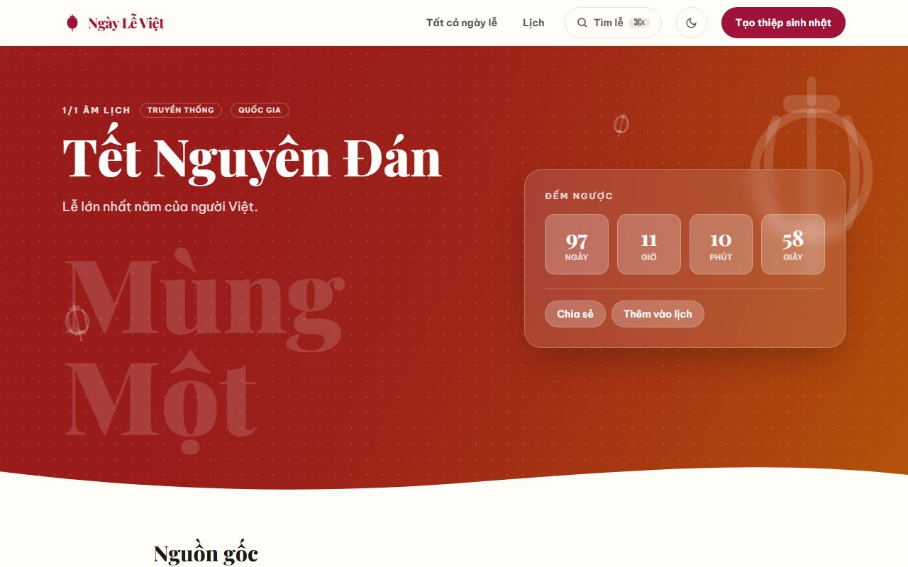
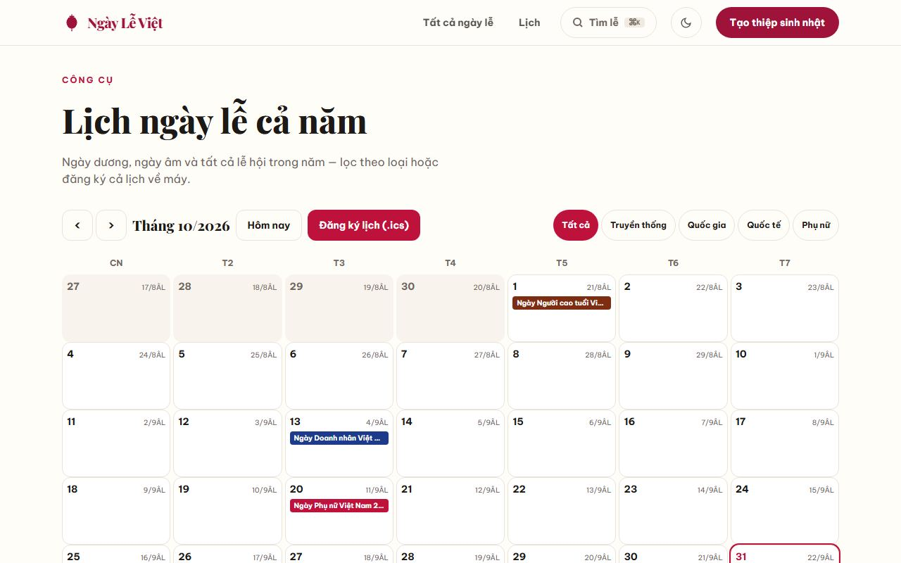
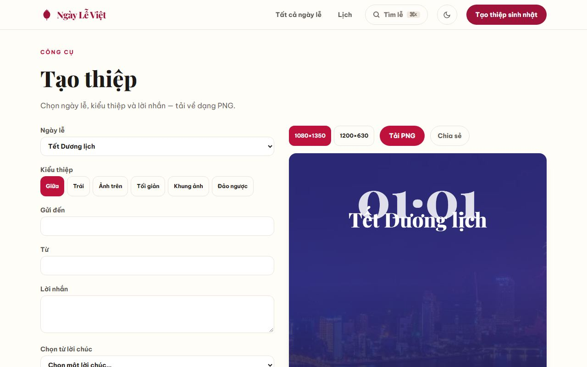
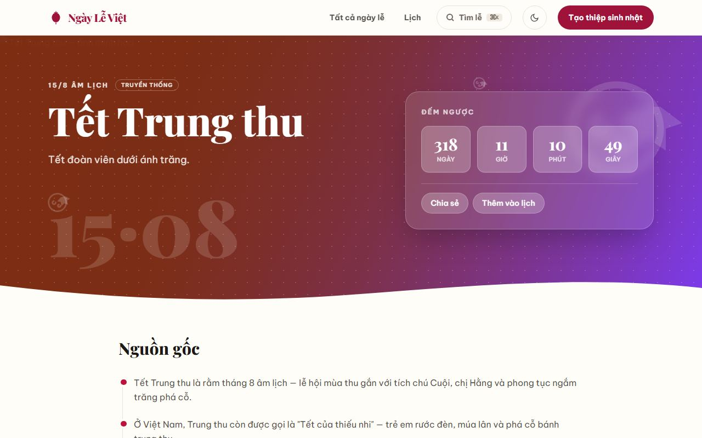
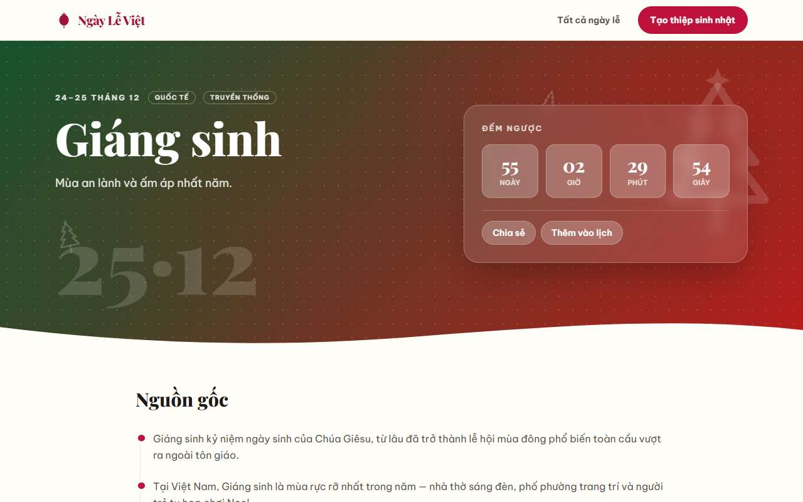
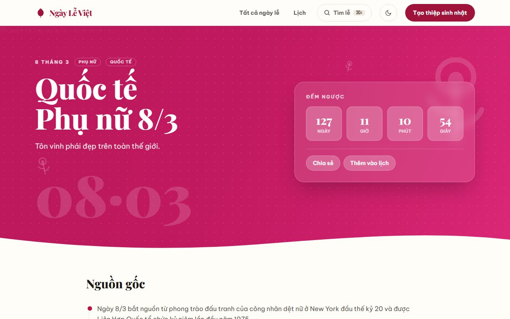
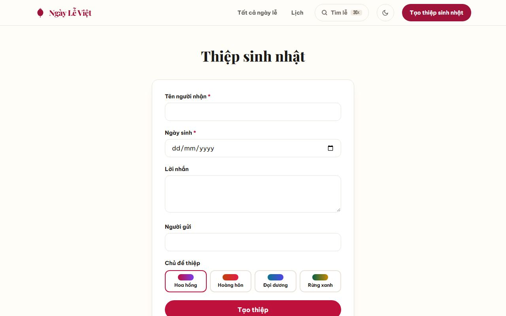

# Ngày Lễ Việt

Trang tĩnh (static) về các ngày lễ Việt Nam và quốc tế — **song ngữ Việt/English** — đọc một trang là hiểu trọn ngày lễ. Next.js App Router + Tailwind CSS, xuất ra HTML tĩnh (`output: 'export'`).

**Live:** https://jasontm17.github.io/All-In-One-Holiday/ · **English:** https://jasontm17.github.io/All-In-One-Holiday/en/

## Tính năng

- **Hai ngôn ngữ** — tiếng Việt tại root (`/`), tiếng Anh dưới `/en/`; chuyển ngôn ngữ bằng nút `VI|EN` trên header (giữ nguyên trang đang xem). Canonical + `hreflang` đầy đủ.
- `/` — trang chủ: hero ảnh, đếm ngược, lịch trình 90 ngày, công cụ nhanh, băng ảnh Việt Nam, lưới 32 ngày lễ.
- `/[slug]/` — 32 trang lễ ×2 ngôn ngữ: đếm ngược, lịch sử, ý nghĩa, phong tục, quà tặng, 5+ lời chúc, câu chuyện & nguồn, **Gợi ý lời chúc** (tạo câu chúc theo tông), và mục **"Hiểu trọn"** — nguồn gốc chi tiết, phong tục & nghi lễ, ẩm thực & lễ vật, và sự thật thú vị.
- `/lich/` — lịch cả năm: ô ngày dương + âm, chip ngày lễ, lọc theo loại, agenda mobile, đăng ký/tải `ngay-le-viet.ics` (3 năm).
- `/thiep/` — tạo thiệp: 6 mẫu, tùy chỉnh người nhận/người gửi/lời chúc, tải PNG (1080×1350, 1200×630), chia sẻ (noindex).
- `/birthday/` — thiệp sinh nhật qua URL, **hỗ trợ cả ngày dương và ngày âm** (`?cal=lunar&lmonth=&lday=&lyear=` — quy đổi âm→dương qua bảng 1900–2100, sinh nhật lặp theo năm âm, tự bỏ qua năm không có ngày ấy) — noindex, không lưu dữ liệu.
- `Ctrl/⌘+K` — tìm ngày lễ không cần dấu.
- Chế độ tối (system + toggle, lưu localStorage), PWA (manifest + service worker, cài được, xem offline).
- `/credits/` — nguồn ảnh theo giấy phép.
- `/accessibility/` — tuyên bố khả năng truy cập (hướng đến WCAG 2.2 AA, hạn chế đã biết, link báo vấn đề).
- `feed.xml` — Atom 1.0 feed song ngữ cho cả 32 ngày lễ, sinh lúc build (`scripts/gen-feed.mjs`); liên kết `<link rel="alternate" type="application/atom+xml">` trong `<head>` và link "Nguồn cấp Atom" ở footer.

## 32 ngày lễ

| Ngày lễ | Thời điểm | Quy tắc |
| --- | --- | --- |
| [Tết Dương lịch](https://jasontm17.github.io/All-In-One-Holiday/tet-duong-lich/) | 1 tháng 1 | Dương lịch |
| [Tết Nguyên Đán](https://jasontm17.github.io/All-In-One-Holiday/tet-nguyen-dan/) | 1/1 Âm lịch | Âm lịch |
| [Tết Nguyên Tiêu](https://jasontm17.github.io/All-In-One-Holiday/tet-nguyen-tieu/) | 15/1 Âm lịch | Âm lịch |
| [Ngày thành lập Đảng Cộng sản Việt Nam](https://jasontm17.github.io/All-In-One-Holiday/ngay-thanh-lap-dang/) | 3 tháng 2 | Dương lịch |
| [Lễ Tình nhân](https://jasontm17.github.io/All-In-One-Holiday/valentine/) | 14 tháng 2 | Dương lịch |
| [Ngày Thầy thuốc Việt Nam](https://jasontm17.github.io/All-In-One-Holiday/ngay-thay-thuoc/) | 27 tháng 2 | Dương lịch |
| [Quốc tế Phụ nữ 8/3](https://jasontm17.github.io/All-In-One-Holiday/quoc-te-phu-nu/) | 8 tháng 3 | Dương lịch |
| [Tết Hàn thực](https://jasontm17.github.io/All-In-One-Holiday/tet-han-thuc/) | 3/3 Âm lịch | Âm lịch |
| [Giỗ Tổ Hùng Vương](https://jasontm17.github.io/All-In-One-Holiday/gio-to-hung-vuong/) | 10/3 Âm lịch | Âm lịch |
| [Tết Thanh minh](https://jasontm17.github.io/All-In-One-Holiday/tet-thanh-minh/) | ~4–5 tháng 4 | Tiết khí (Thanh minh) |
| [Ngày Giải phóng miền Nam 30/4](https://jasontm17.github.io/All-In-One-Holiday/giai-phong-mien-nam/) | 30 tháng 4 | Dương lịch |
| [Quốc tế Lao động 1/5](https://jasontm17.github.io/All-In-One-Holiday/quoc-te-lao-dong/) | 1 tháng 5 | Dương lịch |
| [Ngày Chiến thắng Điện Biên Phủ](https://jasontm17.github.io/All-In-One-Holiday/ngay-dien-bien-phu/) | 7 tháng 5 | Dương lịch |
| [Ngày của Mẹ](https://jasontm17.github.io/All-In-One-Holiday/ngay-cua-me/) | Chủ nhật thứ 2 tháng 5 | Thứ trong tháng |
| [Ngày sinh Chủ tịch Hồ Chí Minh](https://jasontm17.github.io/All-In-One-Holiday/ngay-sinh-nhat-bac/) | 19 tháng 5 | Dương lịch |
| [Tết Đoan Ngọ](https://jasontm17.github.io/All-In-One-Holiday/tet-doan-ngo/) | 5/5 Âm lịch | Âm lịch |
| [Quốc tế Thiếu nhi 1/6](https://jasontm17.github.io/All-In-One-Holiday/quoc-te-thieu-nhi/) | 1 tháng 6 | Dương lịch |
| [Ngày Báo chí Cách mạng Việt Nam](https://jasontm17.github.io/All-In-One-Holiday/ngay-bao-chi/) | 21 tháng 6 | Dương lịch |
| [Ngày Gia đình Việt Nam](https://jasontm17.github.io/All-In-One-Holiday/ngay-gia-dinh-viet-nam/) | 28 tháng 6 | Dương lịch |
| [Lễ Vu Lan](https://jasontm17.github.io/All-In-One-Holiday/vu-lan/) | 15/7 Âm lịch | Âm lịch |
| [Ngày Thương binh Liệt sĩ](https://jasontm17.github.io/All-In-One-Holiday/thuong-binh-liet-si/) | 27 tháng 7 | Dương lịch |
| [Ngày Cách mạng tháng Tám](https://jasontm17.github.io/All-In-One-Holiday/ngay-cach-mang-thang-tam/) | 19 tháng 8 | Dương lịch |
| [Tết Trung thu](https://jasontm17.github.io/All-In-One-Holiday/trung-thu/) | 15/8 Âm lịch | Âm lịch |
| [Quốc khánh 2/9](https://jasontm17.github.io/All-In-One-Holiday/quoc-khanh/) | 2 tháng 9 | Dương lịch |
| [Ngày Người cao tuổi Việt Nam](https://jasontm17.github.io/All-In-One-Holiday/nguoi-cao-tuoi/) | 1 tháng 10 | Dương lịch |
| [Ngày Giải phóng Thủ đô](https://jasontm17.github.io/All-In-One-Holiday/ngay-giai-phong-thu-do/) | 10 tháng 10 | Dương lịch |
| [Ngày Doanh nhân Việt Nam](https://jasontm17.github.io/All-In-One-Holiday/doanh-nhan/) | 13 tháng 10 | Dương lịch |
| [Ngày Phụ nữ Việt Nam 20/10](https://jasontm17.github.io/All-In-One-Holiday/phu-nu-viet-nam/) | 20 tháng 10 | Dương lịch |
| [Ngày Nhà giáo Việt Nam](https://jasontm17.github.io/All-In-One-Holiday/nha-giao-viet-nam/) | 20 tháng 11 | Dương lịch |
| [Ngày Quân đội Nhân dân VN](https://jasontm17.github.io/All-In-One-Holiday/quan-doi-nhan-dan/) | 22 tháng 12 | Dương lịch |
| [Ông Công Ông Táo](https://jasontm17.github.io/All-In-One-Holiday/ong-cong-ong-tao/) | 23/12 Âm lịch | Âm lịch |
| [Giáng sinh](https://jasontm17.github.io/All-In-One-Holiday/giang-sinh/) | 24–25 tháng 12 | Dương lịch |

Ngày âm lịch được quy đổi sang dương lịch từng năm tự động (`src/lib/dates.ts`); Tết Thanh minh theo tiết khí Thanh minh (bảng `QINGMING_TABLE`, 1900–2100).

## English version

The whole site is mirrored in English under `/en/` — every holiday page, the calendar (`/en/lich/`), card maker (`/en/thiep/`), birthday card (`/en/birthday/`) and credits (`/en/credits/`). English content lives in `src/data/holidays-en.ts` + `src/data/stories-en.ts`; UI strings in `src/i18n/en.ts`. See [CONTRIBUTING.md](CONTRIBUTING.md#bilingual-architecture--the-one-rule-that-matters) for the architecture rules.

## Public JSON API

`public/api/holidays.json` is regenerated at build time (`npm run gen:api` — also runs inside `npm run build` via `prebuild`). Shape:

```jsonc
{
  "generatedAt": "…ISO…",
  "locales": ["vi", "en"],
  "count": 32,
  "holidays": [
    {
      "slug": "tet-nguyen-dan",
      "locale": "vi" | "en",
      "name": "…",
      "dateMark": "…",
      "displayDate": "…",
      "categories": ["truyen-thong", "quoc-gia"],
      "tagline": "…",
      "meaning": "…",
      "traditions": [{ "title": "…", "text": "…" }],
      "wishes": ["…"],
      "gifts": [{ "title": "…", "text": "…" }],
      "rule": { "type": "lunar", "month": 1, "day": 1 },
      "nextOccurrence": "YYYY-MM-DD",
      "occurrenceThisYear": "YYYY-MM-DD"
    }
    // …64 entries (32 holidays × 2 locales)
  ]
}
```

Date rules: `solar` (Gregorian month/day), `lunar` (Vietnamese lunar month/day), `nth-weekday` (e.g. 2nd Sunday of May), `qingming` (Qingming solar term).

### Theo nhóm

- **Truyền thống:** Tết Nguyên Đán, Tết Nguyên Tiêu, Giỗ Tổ Hùng Vương, Tết Thanh minh, Lễ Vu Lan, Tết Trung thu, Ông Công Ông Táo, Tết Hàn thực, Tết Đoan Ngọ, Giáng sinh.
- **Quốc gia:** Giải phóng miền Nam, Quốc tế Lao động, Gia đình Việt Nam, Thương binh Liệt sĩ, Quốc khánh, Phụ nữ Việt Nam, Nhà giáo Việt Nam, Quân đội Nhân dân, Thầy thuốc, Báo chí Cách mạng, Người cao tuổi, Doanh nhân, Thành lập Đảng, Điện Biên Phủ, Sinh nhật Bác, Cách mạng tháng Tám, Giải phóng Thủ đô.
- **Quốc tế:** Tết Dương lịch, Lễ Tình nhân, Quốc tế Phụ nữ 8/3, Quốc tế Lao động, Ngày của Mẹ, Quốc tế Thiếu nhi, Giáng sinh.
- **Phụ nữ & gia đình:** Quốc tế Phụ nữ 8/3, Ngày của Mẹ, Phụ nữ Việt Nam, Lễ Vu Lan, Gia đình Việt Nam.

## Ảnh chụp

| Trang chủ | Tết Nguyên Đán | Lịch cả năm |
| --- | --- | --- |
|  |  |  |

| Tạo thiệp | Trung thu | Giáng sinh |
| --- | --- | --- |
|  |  |  |

| 8/3 | Sinh nhật | Mobile |
| --- | --- | --- |
|  |  |  |

## Chạy

```bash
npm install
npm run dev        # dev server
npm run build      # xuất site tĩnh ra thư mục out/
npm test           # test logic ngày tháng + dữ liệu (vitest)
npm run test:e2e   # e2e + axe a11y (Playwright, cần build trước)
npm run lint
npm run check:links # kiểm tra link nguồn trong stories
```

## Design system

Chi tiết nghiên cứu + token đầy đủ: [`docs/design-references.md`](docs/design-references.md).

- **Hướng thẩm mỹ**: festive editorial — hero "drenched" theo màu riêng của từng ngày lễ, nội dung trung tính ấm tối giản.
- **Màu**: token trong `@theme` ở `src/app/globals.css` (`--color-ink/muted/faint/surface/card/line/band/soft/brand`), có bản dark trong `html.dark`. Mỗi holiday có `theme.from/to` gradient riêng.
- **Chữ**: Playfair Display (tiêu đề, có subset Vietnamese) + Be Vietnam Pro (nội dung). Nhạy số: `tabular-nums`.
- **Bố cục**: radius thống nhất 16px card / pill nút; chiều sâu = hairline + một lớp shadow tint; motif SVG riêng mỗi ngày lễ (`src/components/Motif.tsx`).
- **Motion**: IntersectionObserver reveal (`Reveal.tsx`), marquee, float ornaments; tôn trọng `prefers-reduced-motion`; countdown `aria-hidden` với nhãn tĩnh.
- **Ảnh**: lấy từ nguồn mở (Unsplash/Wikimedia…), tối ưu thành WebP đa kích thước trong `public/images/holidays/`, ghi nguồn đầy đủ tại `/credits/` và `src/data/image-credits.ts`. Không dùng emoji hay asset có bản quyền chưa rõ.

## Thêm một ngày lễ

Chi tiết đầy đủ: [CONTRIBUTING.md — Adding a holiday](CONTRIBUTING.md#adding-a-holiday).

1. Thêm entry vào `src/data/holidays.ts` (VI) **và** `src/data/holidays-en.ts` (EN) — cùng `slug`, cùng vị trí.
   - `rule` — `{ type: 'solar', month, day }`, `{ type: 'lunar', month, day }`, `{ type: 'nth-weekday', month, weekday, nth }`, hoặc `{ type: 'qingming' }`
   - `motif` — tên ornament trong `Motif.tsx`
   - `theme`, `history`, `traditions`, `wishes` (≥5), `gifts`, `faq`, và `deep`
2. Thêm story trong `src/data/stories.ts` + `src/data/stories-en.ts` (≥3 nguồn https; nguồn tiếng Anh cho EN).
3. Ảnh qua `scripts/fetch-images.mjs <slug> --fill` + `scripts/gen-thumbs.mjs`, credits tự ghi vào `image-credits.ts`.
4. `npm run gen:data && npm test` — parity + data-integrity tests sẽ kiểm tra đủ trường. Không cần thêm route.

## Triển khai

`npm run build` → nội dung trong `out/` đẩy lên bất kỳ static host nào.

- **Custom domain**: build mặc định (không env).
- **GitHub Pages** (`<user>.github.io/All-In-One-Holiday/`): build với `NEXT_PUBLIC_BASE_PATH=/All-In-One-Holiday` và `NEXT_PUBLIC_SITE_URL=https://<user>.github.io/All-In-One-Holiday`. Workflow `.github/workflows/pages.yml` đã cấu hình sẵn cho repo này; bật Pages → Source: GitHub Actions.

## Thiệp sinh nhật

`/birthday/?name=<tên>&date=<YYYY-MM-DD>&msg=<lời nhắn>&from=<người gửi>&theme=<hoa-hong|hoang-hon|dai-duong|rung-xanh>` — không lưu trữ dữ liệu cá nhân; trang `noindex`.

**Sinh nhật âm lịch:** `/birthday/?cal=lunar&lmonth=<tháng âm 1–12>&lday=<ngày âm 1–30>&lyear=<năm âm, tuỳ chọn>&name=<tên>` — quy đổi âm→dương qua `LUNAR_TABLE` (1900–2100), chỉ dùng tháng thường (không tháng nhuận), tự quét các năm sau khi năm âm không có ngày ấy (vd. 30/4 âm thiếu). Hiển thị cả hai ngày ("âm 15/8 — dương 6/10/2026"), đếm ngược tới ngày dương; tuổi chỉ hiển thị khi có `lyear`. Tham số `date=` (dương) vẫn hoạt động như cũ.

## Đóng góp

Xem [CONTRIBUTING.md](CONTRIBUTING.md). Các file cộng đồng: [SECURITY.md](SECURITY.md), [CODE_OF_CONDUCT.md](CODE_OF_CONDUCT.md).

- Branch mới từ `main`, conventional commits (`feat:`, `fix:`…).
- Trước khi mở PR: `npm run lint && npx tsc --noEmit && npm test && npm run build && npm run test:e2e` phải xanh.
- Không commit dữ liệu cá nhân, secrets, hay file trong `.gitignore`.

## License

MIT — xem `LICENSE`.
