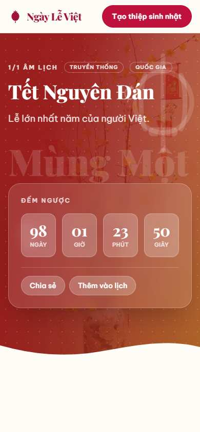
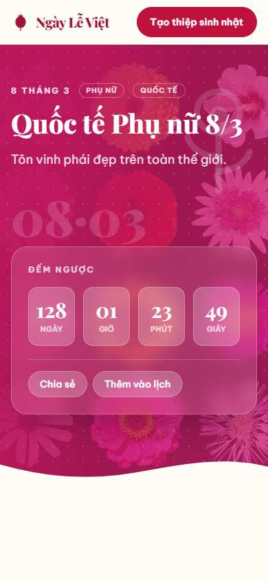
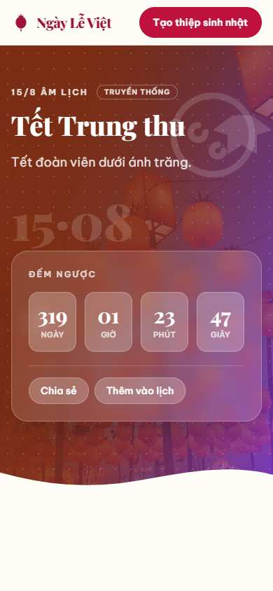
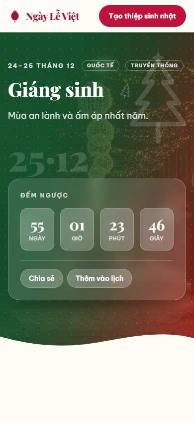
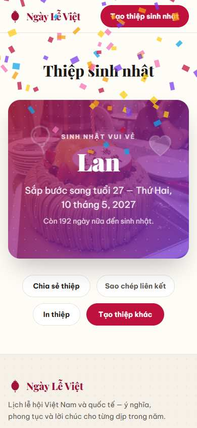

# Design references — Ngày Lễ Việt

Research log for the festive-editorial direction of this site. Studied Oct 2026.
No third-party screenshots are reproduced (copyright) — captures below are **our own
pages** (see `docs/images/`).

## References studied

| # | Reference | What to learn | Palette (sampled/described) | Applied where |
|---|-----------|---------------|------------------------------|----------------|
| 1 | [A HAPPY NEW YEAR 2024 — Awwwards nominee (Qlip)](https://www.awwwards.com/sites/a-happy-new-year-2024) | Festive sites win by making the hero a *scene* (3D dragon backdrop), not a banner. | Deep festive red field + gold type | Layered hero scene per holiday — gradient mesh + dot texture + floating motif SVGs (`[slug]/page.tsx` hero, `Motif.tsx`) |
| 2 | [KNOCK — Lunar New Year Election (Awwwards HM)](https://www.awwwards.com/sites/lunar-new-year-election) | Cultural palettes can be minimal: 3 committed colors, not a rainbow. | `#000000` / `#DF6C4F` / `#ECD06F` | Two-stop discipline: every holiday theme is exactly `from` + `to` + one accent (`holidays.ts` → `theme`) |
| 3 | [Floxies Challenge Lunar Year — Webflow](https://webflow.com/made-in-webflow/website/floxies-challenge-lunar-year) | Cultural storytelling > decoration; scroll is a journey through traditions. | Vermilion + cream + jade | History rendered as a timeline rail, traditions as bento cards — narrative rhythm, not a wall of text (`[slug]/page.tsx`) |
| 4 | [Framer — "Halloween" event template (Struxent)](https://www.framer.com/marketplace/templates/halloween/) | Poster-inspired oversized headline gives a holiday instant identity. | Orange + black poster palette | Oversized `dateMark` watermark behind each hero title (e.g. `15·08`, `Mùng Một`) at `clamp(4.5rem,12vw,9rem)` |
| 5 | [Framer — "Halflight Fest" template](https://www.framer.com/marketplace/templates/halflight-fest/) | Hot single accent + hover lifts + scrolling ticker keep energy high with minimal elements. | Ink + hot orange accent | Wishes marquee strip (`marquee` CSS), card hover `translateY(-3px)` lift (`globals.css .card`) |
| 6 | [Playfeti — Webflow event template](https://webflow.com/templates/html/playfeti-website-template) | Collage-style hero + "bring your friends" social framing for celebration sites. | Playful multi-pastel + saturated CTAs | Home's illustrated featured-holiday card + dedicated CTA band for the shareable birthday card (`NextHolidayHero`, home CTA section) |
| 7 | [Assemble — Framer event template (Bryn Taylor)](https://onepagelove.com/assemble) | Sticky nav with a single primary CTA is the event-site standard. | Neutral + one CTA hue | Sticky header, single brand CTA "Tạo thiệp sinh nhật" (`Header.tsx`) |
| 8 | [Stripe.com — section rhythm](https://stripe.com) | Restraint between loud moments: hairline dividers, stat strips, generous whitespace. | Tinted neutrals + saturated accent | Stat strip fused into hero edge; hairline `divide-x`/`border` system instead of heavy shadows (`page.tsx`, `.card`) |
| 9 | [Linear.app — glass & glow](https://linear.app) | Glassmorphism works when the background is rich enough to blur. | Dark field + soft radial glows | `.glass` countdown card over gradient heroes (`HolidayActions`, `RuleCountdown`, `NextHolidayHero`) |
| 10 | [Land-book — landing pattern curation](https://land-book.com) | Recurring winners: eyebrow labels, 2-line hero H1, one CTA per view, FAQ accordion near the fold's end. | — | `eyebrow` tracking labels, `clamp()` H1 capped at 2 lines, FAQ as final section before prev/next nav |

## Project design tokens

### Per-holiday palettes & white-text contrast

| Holiday | from → to | Contrast (white on from / to) |
|---|---|---|
| Tết Dương lịch | `#312e81 → #7c3aed` | 8.7 / 4.0 |
| Tết Nguyên Đán | `#991b1b → #b45309` | 7.0 / 4.4 |
| Tết Nguyên Tiêu | `#7f1d1d → #ea580c` | 7.5 / 3.2 |
| Valentine | `#9f1239 → #e11d48` | 7.4 / 4.4 |
| Quốc tế Phụ nữ | `#be185d → #db2777` | 6.1 / 4.6 |
| Giỗ Tổ Hùng Vương | `#854d0e → #166534` | 4.9 / 6.6 |
| 30/4 Giải phóng | `#b91c1c → #b45309` | 6.5 / 4.4 |
| 1/5 Lao động | `#9a3412 → #0369a1` | 4.9 / 5.8 |
| Ngày của Mẹ | `#be123c → #db2777` | 6.4 / 4.6 |
| 1/6 Thiếu nhi | `#0369a1 → #b45309` | 5.8 / 4.4 |
| Gia đình VN | `#065f46 → #c2410c` | 7.2 / 3.9 |
| Thương binh Liệt sĩ | `#881337 → #292524` | 7.3 / 12.4 |
| Vu Lan | `#4c1d95 → #b45309` | 9.1 / 4.4 |
| Quốc khánh | `#b91c1c → #b45309` | 6.5 / 4.4 |
| Trung thu | `#7c2d12 → #7c3aed` | 6.8 / 4.0 |
| Phụ nữ VN 20/10 | `#be123c → #a21caf` | 6.4 / 6.3 |
| Nhà giáo VN | `#065f46 → #4d7c0f` | 7.2 / 4.1 |
| Quân đội 22/12 | `#14532d → #a16207` | 7.5 / 4.0 |
| Giáng sinh | `#14532d → #b91c1c` | 7.5 / 6.5 |

Rule: both stops keep white ≥3:1 (large display text ≥18px/bold). Neutral ramp lives in
`globals.css @theme`: `--color-ink #1c1917`, `--color-muted #57534e`,
`--color-faint #6e665e` (4.7:1 on surface — AA), `--color-surface #fffdf8`,
`--color-line #e9e3da`, `--color-brand #be123c`, `--color-brand-deep #9f1239`.

### Typography scale

| Role | Font | Size |
|---|---|---|
| Display H1 (hero) | Playfair Display 800 | `clamp(2.6rem, 5.5vw+1rem, 5rem)` |
| Page H1 (holiday) | Playfair 800 | `clamp(2.4rem, 5vw+1rem, 4.5rem)` |
| H2 | Playfair 700-800 | `clamp(1.6–1.8rem, 3vw, 2.4–2.6rem)` |
| Date watermark | Playfair 900 | `clamp(4.5rem, 12vw, 9rem)` |
| Body | Be Vietnam Pro 400 | 16–18px, line-height 1.6–1.75 |
| Eyebrow label | BVP 700 caps | 0.72rem, +0.22em tracking |
| Numbers | `tabular-nums` | countdown tiles, stats |

### Spacing & surfaces

- 4pt scale; sections separated by 56–96px (`py-14`/`py-16`/`space-y-20`).
- One radius system: cards 16px, pills for buttons/chips, 14px tiles.
- One depth strategy: hairline `#e9e3da` border + single warm-tinted shadow
  (`0 12px 28px -14px rgb(120 60 40 / 0.14)`); hover lift −3px.

### Motion rules

- Easing token `--ease-out-quint: cubic-bezier(0.22,1,0.36,1)`; 150–300ms
  interactions, ~600ms reveals.
- Reveal on scroll via `IntersectionObserver` (`Reveal.tsx`) — content is
  visible without JS; hidden pre-paint only when JS runs.
- Max 1 marquee per page, pauses on hover/focus; `floaty` ornaments 7–11s.
- `prefers-reduced-motion` collapses everything (marquee becomes static wrap,
  reveals disabled, confetti skipped).
- Countdown digits are `aria-hidden`; a static `role="timer"` label carries
  meaning (ARIA live=off → no per-second announcements).

## Our pages (self-captures)

| Page | Desktop | Mobile |
|---|---|---|
| Home |  |  |
| Tết Nguyên Đán |  |  |
| Quốc tế Phụ nữ 8/3 |  |  |
| Trung thu |  |  |
| Giáng sinh |  |  |
| Thiệp sinh nhật |  |  |

## Photography (round 4-5)

All photography is free-license (Wikimedia Commons: CC0/CC BY/CC BY-SA/PD) — curated per-holiday, stored locally in `public/images/holidays/<slug>/` (hero 1600-1920w + card + gallery ×3, all ≤~250KB webp; `hero-sm` 800w variants feed `srcset`). Photos sit under palette gradient overlays (40-60% opacity) so AA holds. Credits: `public/images/CREDITS.md`, `src/data/image-credits.ts`, and the `/credits` page. Fetch/curation tooling: `scripts/fetch-images.mjs`, `scripts/contact-sheets.mjs`.
